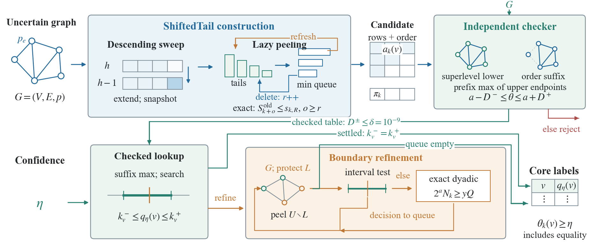
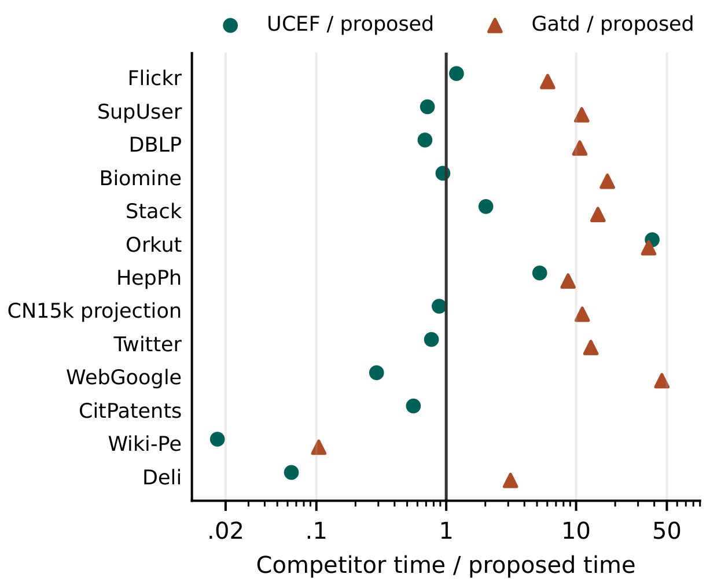

# ShiftedTail

*Building and Verifying All-Level Core Thresholds in Uncertain Graphs*

The C++ builder computes a core threshold for each eligible vertex and degree. A separate verifier reads the thresholds and the removal order.



## Reproduce

The [reproduction guide](docs/REPRODUCE.md) covers the full datasets, CPU/GPU baselines, ablations, strict checking, exact queries, and paper figures. It includes the original study drivers and recorded observations. The [source attribution](docs/BASELINES.md) distinguishes author implementations from reconstructed comparison kernels.

With the C++/GMP toolchains configured as in that guide:

```powershell
python -m pip install -r requirements.txt
python reproduce.py dependencies boost dai
python reproduce.py build
python reproduce.py smoke
python reproduce.py fetch-data Twitter CN15kProjection Flickr SupUser
python reproduce.py prepare Twitter CN15kProjection Flickr SupUser
python reproduce.py benchmark work/literature_coverage/Twitter/Twitter.bin outputs/twitter --rounds 5
python reproduce.py figures
```

Fresh measurements are kept separate from the paper's recorded results. See the [executed release checks](docs/validation/README.md).

## Minimal example

Requires x64 Windows, an AVX2 processor, Visual Studio C++ Build Tools with LLVM OpenMP, and Python 3.10 or later.

```powershell
.\build.cmd
python run_example.py
```

The input is an [undirected edge list](data/edges.csv) with columns `u,v,probability`. On the four-vertex graph, the builder writes seven thresholds. The verifier checks them, and the example compares each value with exhaustive vertex-subset evaluation.

## Construction time



Each point compares two builders on the same graph. Values above 1 favor ShiftedTail. On Stack Overflow all three wrote 28,341,100 thresholds. ShiftedTail took 38.9 s, UCEF’s parallel threshold stage took 78.6 s and the corrected Gatd GPU port took 573.3 s. [Per-graph times](data/construction-times.csv)

On four complete graphs, disabling the shifted bound while retaining reuse multiplied median single-worker build time by 5.07 on Flickr, 8.50 on SupUser, 1.55 on DBLP and 11.84 on CN15k. UCEF finished first on DBLP. [Five-arm comparison](data/full-graph-summary.csv) · [100 runs](data/full-graph-ablation.csv)
