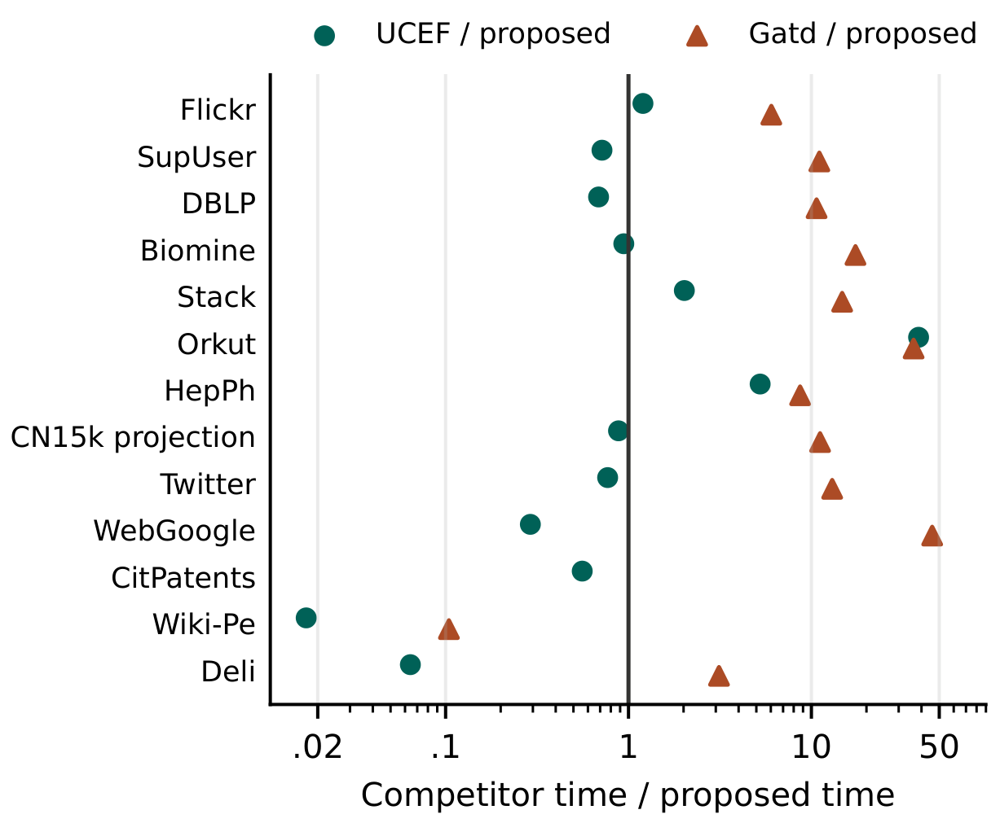

# Building and Verifying All-Level Core Thresholds in Uncertain Graphs

The shifted-tail builder stores survival probabilities during peeling. After a neighbor disappears, shifting the required degree gives a lower bound on the remaining survival probability.

**Reading Figure 1.** Points to the right of 1 favor the shifted-tail builder. On Stack Overflow it wrote 28.3 million thresholds in **38.9 s**. UCEF’s parallel threshold stage took **78.6 s** and the corrected Gatd GPU port took **573.3 s**.

On the four-vertex example, the checker compares all seven stored thresholds with exhaustive subset evaluation. Run on x64 Windows with Python 3.10+, AVX2 and Visual Studio C++ Build Tools with LLVM OpenMP.

~~~powershell
.\build.cmd
python run_example.py
~~~
